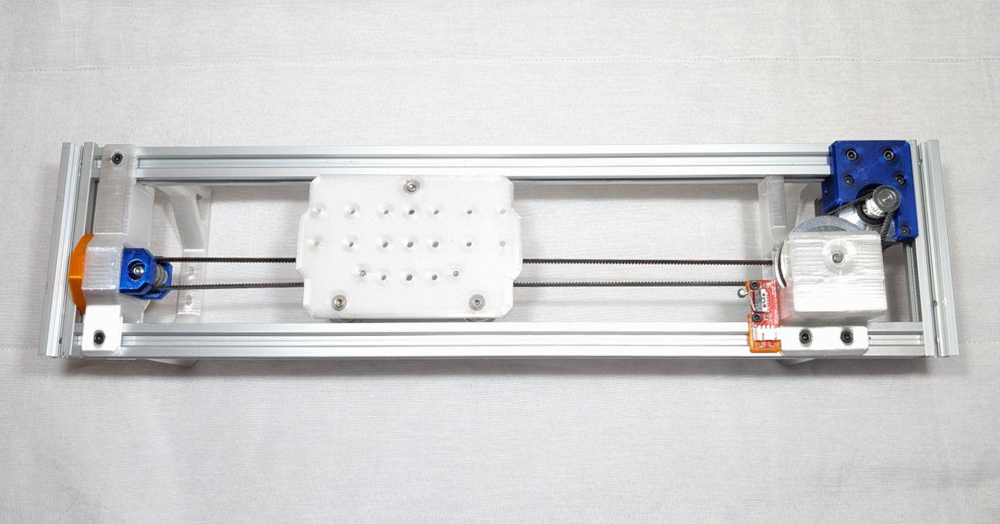
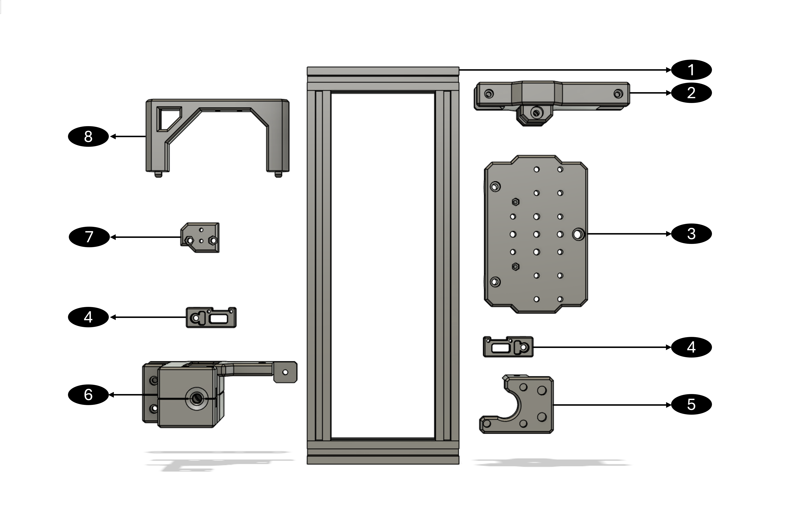

# Drive Unit Library

Open design files, configuration tools and guides for a belt-driven linear drive unit: a single-axis motion module built from 2020 V-slot extrusion, GT2 belts and pulleys, a NEMA 17 stepper, POM V-wheels and 625ZZ bearings, with PETG printed structure. The same unit can be repeated, resized and combined into multi-axis machines. Bought parts are specified by commodity family so they can be sourced from more than one supplier.

The repository carries the whole path from parts to motion: design files, bill of materials, assembly guide, a calculator that generates the Marlin configuration from physical axis parameters, a browser-based operator panel for commissioning and operation, and step-by-step guides.

## Where to start

1. Read [docs/BOM.md](docs/BOM.md) and source the parts.
2. Print the parts using the settings in [cad/README.md](cad/README.md).
3. Build the mechanism with [docs/ASSEMBLY_GUIDE.md](docs/ASSEMBLY_GUIDE.md).
4. Wire and bring up the controller with [Guide 0](docs/guides/Guide_0_Bench_Bringup.md), then follow the [Quick Start](docs/guides/Quick_Start_Guide.md): generate the configuration with the Calculator, build and flash Marlin, connect, and home.
5. Use the Operator for routine motion. Further guides cover [endstops](docs/guides/Guide_1_Endstops.md), [multi-axis machines](docs/guides/Guide_2_MultiAxis_Machine.md), [sensorless homing](docs/guides/Guide_3_Sensorless_Homing.md) and [dual homing](docs/guides/Guide_Advanced_Dual_Homing.md).

Versions that belong together are listed in [COMPATIBILITY.md](COMPATIBILITY.md).

The parts of the drive unit, as numbered in the diagram below: (1) structural frame, (2) main-belt tensioner, (3) carriage, (4) reversible endstop mount, (5) adjustable motor mount, (6) transmission module, (7) cable-management adapter, (8) cross-brace.

## Contents and licences

This repository is not released under a single licence. Each folder carries its own, and `LICENSE.md` gives the full table.

| Folder | Contents | Licence |
|---|---|---|
| `cad/` | Editable STEP model and 3MF print files | CERN-OHL-P-2.0 |
| `firmware/` | Marlin configuration files | GPL-3.0 |
| `software/` | Drive Unit Calculator and Operator (single-file HTML) | MIT, with embedded fonts under the SIL Open Font License (see `software/THIRD_PARTY_NOTICES.md`) |
| `docs/` | Bill of materials, assembly guide, guides | CC BY 4.0 |
| `data/` | Vibration measurement records (CC BY 4.0); analysis script and G-code (MIT) | see `data/README.md` |

## Status and known gaps

- The Operator and Calculator were verified in a headless browser with a mocked serial port. Behaviour on a physical controller is not covered by that check.
- Specification figures were measured on one reference instance (DU-220/540), not on every configuration the Calculator can generate.

## Safety

The unit is a 24 V stepper-driven mechanism with moving belts and pulleys. Keep hands clear while the controller is powered, and test new configurations at low speed with the stop control within reach. The files are provided as is, with no warranty (see the licences).

## Citation

A formal citation will be added when the associated thesis is published.
